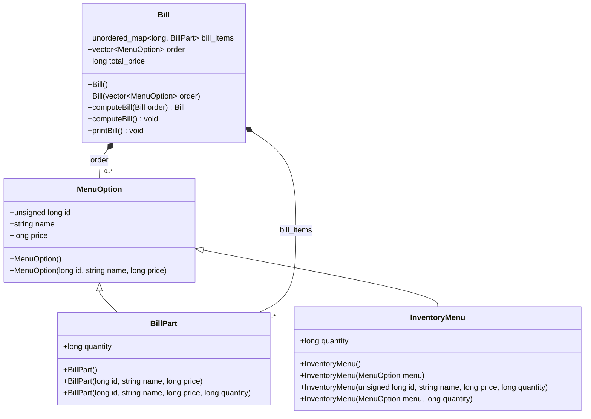
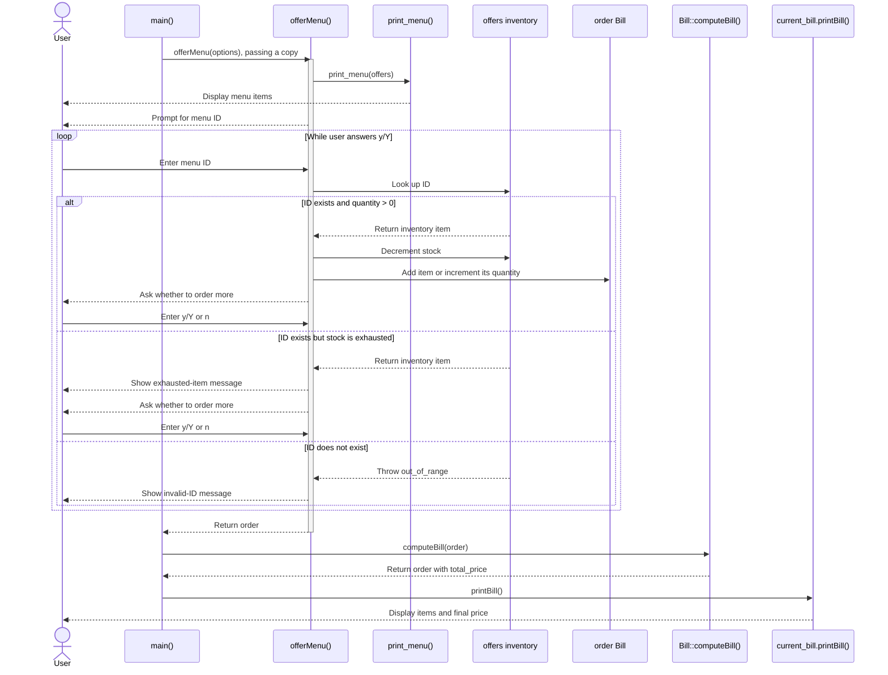

# Instruction
There are two tags
1. base_case which implement Base case scenario which was defined in case 1
2. limited_stock which implement base_case with improvement on Quantity menu as constraint

## Class diagram

## Sequence diagram

